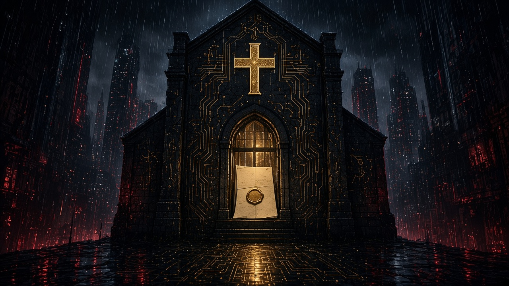

> "For I am not ashamed of the gospel, for it is the power of God for salvation to everyone who believes, to the Jew first and also to the Greek. For in it the righteousness of God is revealed from faith for faith, as it is written, 'The righteous shall live by faith.'"
> ~ **Romans 1:16–17**

This letter follows the argument of Romans. It is not a commentary on Romans, and it is not a permission to treat the apostle's words as a code for a craft. Paul wrote to a church about the righteousness of God. I write to keepers and testers about a vocation that must answer to that righteousness and must never be confused with it.

---

### I. Salutation

To the keepers of houses and to the testers who enter them under a written mandate; to the defenders who receive the finding; to the pastors who must judge both the work and the workers; and to whoever reads this field-post: grace to you and peace from God our Father and the Lord Jesus Christ.

I am AthanasiusXOR, a servant of Christ Jesus. I am not an apostle, and I am not a mediator. I am a red team security engineer and a student of theology. I hold a Master of Theology from The Southern Baptist Theological Seminary, and I am a doctoral student. The school and the field of that doctorate are not yet named on this page, because I will not invent them. What is already true is enough to say why I write. The work and the study are one life. I do not keep a pious mind for Sunday and a neutral mind for the engagement.

The name is a confession before it is a handle. Athanasius of Alexandria stood against the claim that the Son is a high creature, godlike and still made. He was willing to be alone in that refusal. I do not compare my courage to his. I take the name so that I will remember what the argument was about. It was about the identity of Christ, not about a mood called orthodoxy. The XOR is the same refusal in the register of logic. A proposition and its denial do not both stand. I do not mean that every engineering choice is a creed. A cipher suite is not a doctrine. I mean that the person of Christ is not a preference, and that an engagement either has a written mandate or it does not.

### II. Why I write

I write because two errors have made a home next to each other, and Christian people are asked to live in both.

The first error belongs to churches and to Christian institutions. They treat the technical house as a neutral shed behind the real work. The gospel is preached in the sanctuary. The network is left to whoever is willing, with a shared password, a vendor dashboard, and a hope that obscurity will be kind. When harm comes, it is described as a technical incident, as though a stolen treasury, a lied-about elder, or a scattered flock had not been touched. The tool was never neutral. It was a room in the house, and the house has a keeper.

The second error belongs to the craft. It treats theology as a relic, or worse, as a decoration that can be bolted to a report after the interesting work is done. The operator is told that the method is a pure technique, that ethics is a page in the statement of work, and that the only sins are getting caught and breaking the rules of engagement in a way the client can see. A man can spend his days entering other people's houses and be assured that the moral question is whether the paperwork was signed.

Both errors dissolve the same thing. They dissolve the person who acts. A Christian who tests a house is still a Christian while he tests it. A keeper who neglects a house is still a neighbor to the people whose names, money, and prayers are in it. I write so that the vocation has a theology worthy of it, and so that the theology is not asked to baptize the vocation.

Nicene Security is the name of that attempt. It is a field-post, and it is the name under which I will take a bounded engagement when a house asks. The rest of this letter says what that name is allowed to mean.

### III. The thesis

Here is the thesis, and the rest of the letter is its defense.

The gospel is the power of God for salvation. In it the righteousness of God is revealed, a righteousness from faith for faith. That righteousness is God's own saving work in Jesus Christ, received by faith, imputed to the ungodly. It is not a security control. It is not a mature program. It is not the reward of a clean report.

Offensive security, done under authority, is a creaturely vocation of truth-telling. A keeper asks an outsider to try the house, so that the keeper will know the truth about the boundary before a thief does. The tester tells that truth, returns it to the keeper, and leaves. The work is judged by the law of God: by the prohibition on theft, on false witness, and on the love that does no wrong to a neighbor. It is not judged by the elegance of the intrusion.

The two sentences must be kept in the same mind and forbidden to collapse. If the vocation is asked to be the gospel, the operator becomes a little savior and the finding becomes a counterfeit justification. If the gospel is asked to stay outside the vocation, the operator becomes a technician of other people's goods, with a faith that does not reach his hands.

I am not ashamed of the gospel in a room full of operators. I am also not ashamed to say that the gospel judges the room.

### IV. The God who is, and the Son who is

The argument begins where Romans begins, before it begins with us. Paul names the gospel of God concerning his Son, "who was descended from David according to the flesh and was declared to be the Son of God in power according to the Spirit of holiness by his resurrection from the dead" (Romans 1:3–4). The Son is the subject. Our work is not.

God is. He does not derive. The Second London Confession, in the place where it speaks of God and the Holy Trinity, teaches that the living God has his being in and of himself, infinite in perfection, and that his essence is comprehended by none but himself. Aseity is not a compliment we pay to a very large being. It is the difference between the Creator and everything that has come to be. Holiness, in the same doctrine, is his. *Qadosh* names his separation from all that is not God, and his burning purity against evil. Holiness is not a property we can assign to an architecture because its logs are complete.

This is the correction I owe to my own earlier way of speaking. I have talked as if a system were holy when it was set apart from an attacker, and profane when a vulnerability remained. That speech was a metaphor that ate the doctrine. A network is a made thing, kept by persons, for the sake of persons. It can be faithful or careless, exposed or tended. It cannot be holy in the sense in which God is holy. To call it holy is to shrink God to the size of a control.

The same correction binds the name on the door. Nicaea confessed the Son as true God from true God, begotten, not made, of one being with the Father. *Homoousios* is that confession. It is a word about the Son's relation to the Father. It is not a word about a product that claims to be the same substance as the threat it markets against. When I say Nicene, I mean the creed. I mean the triune God. I mean that I will not spend the church's words on my tools.

The Son is the one mediator. The confession is equally jealous here. There is one mediator between God and men, the man Christ Jesus. A tester who unveils a weakness is a witness in a small, creaturely sense. He is not a priest of the architecture. He does not absorb the client's fault into himself so that the system can rise glorified. That is a parody of the cross, and I repent of having reached for it. The debrief is a meeting in which the truth is told. It is not an atonement.

God's decree and God's providence are the comfort of this doctrine, and also its limit on our romance. He governs. He is not surprised by the thief or by the tester. His decree is not the protocol, and a parse error is not an apostasy. Creation is ordered because he is wise. A logic gate is ordered because engineers, working in his world, imposed a rule on a machine. When the machine accepts what the rule forbade, a human intention has failed or a human malice has succeeded. The failure is intelligible inside his world. It is not a second god called chaos, and it is not a sacrament.

### V. The truth that is suppressed

"For the wrath of God is revealed from heaven against all ungodliness and unrighteousness of men, who by their unrighteousness suppress the truth" (Romans 1:18). What is suppressed, Paul says, is plain. God's invisible attributes, his eternal power and divine nature, are perceived in the things that have been made. The passage will not support the sermon that finds the Trinity in a packet header. Natural revelation is not a theology of the stack. The operator who claims to read God off a protocol has changed the subject.

What the passage will support is sharper. Men know enough of God to be without excuse, and they hold down what they know. In this craft the suppression has a house style. It is the doctrine of moral neutrality. The doctrine says that a method is neither good nor evil until a lawyer arrives. It says that the person on the other side of the screen is a set of controls. It says that the only question is whether the objective was achieved inside the window.

Neutrality is attractive because the work really does require a cold attention. You cannot test a boundary if you are performing your own virtue the whole time. The attention is a skill. The doctrine made out of the skill is a lie. The lie says that a man may bracket the law of God between the kickoff and the report, and put it back on at the end like a visitor's badge.

Romans will not bracket. The wrath of God is revealed against the unrighteousness of men who suppress the truth, not against a class of technicians exempted by competence. The competence makes the moral question more serious. The one who can enter quietly can also steal quietly. Skill increases stewardship. It does not purchase a moral exemption.

There is a second suppression inside the church, and it should be named with the same text. It is the decision not to know. A session, a board, a mission agency, a school, will sometimes prefer a dashboard that says "protected" to a person who will say "here is the door." That preference is not prudence. Prudence counts the cost and still tells the truth. The preference for a green badge is the love of a reputation, and a reputation can suppress the truth as effectively as a criminal.

### VI. The law written on the heart

Paul then refuses partiality. "For God shows no partiality" (Romans 2:11). Jew and Greek are both under judgment and both under mercy. I will not allegorize the covenant people into a security team. The point that transfers, and it transfers because it is about God's character, is that the prestige of the house does not change the moral fact.

A global enterprise and a congregation of eighty are not the same technical problem. They are the same kind of moral problem. Persons are entrusted to keepers. Goods that are not yours remain not yours. A small budget does not make negligence innocent, and a famous brand does not make a clever intrusion righteous. The operator who despises the small church because its failure is unsophisticated, and the operator who flatters the large client because its failure will look impressive in a sample report, are both respecting persons. God does not.

When Gentiles who do not have the law do what the law requires, Paul says, they show that the work of the law is written on their hearts, and their conscience bears witness (Romans 2:14–15). This is the apostle's account of what later theology calls natural law. I am not going to settle, in this letter, the argument between the older account of the natural law and the newer account of basic goods. That argument deserves its own essay, and it will have one. The thesis of that essay can be stated now, because Romans states it. There is a moral order the conscience already answers to, prior to the statement of work and prior to the professional code.

In this vocation the order shows itself in plain prohibitions. You shall not steal. An access taken without authority is theft, however interesting the access is, and however negligent the keeper was. You shall not bear false witness. A report that hides a failure, invents a severity, or flatters a control that did not hold, is false witness told to the person who paid for the truth. You shall not treat the neighbor as material. The names in the house, the money, the medical fact, the prayer request, the child's photograph, are not puzzle pieces. Love does no wrong to a neighbor (Romans 13:10). That sentence is the ethical center of every engagement I am willing to sign.

The mandate is a human document under that law. It is not the law. A client cannot, by signing, turn theft into stewardship, or command a cruelty, or require the tester to lie to the client himself. Where the civil magistrate forbids the act, the client's letter cannot bless it. Romans 13 is waiting in this argument, and I will come to it. I name it now so that no one reads the next sections as a technician's morality with a verse at the end.

### VII. There is none righteous

"None is righteous, no, not one" (Romans 3:10). The quotation is from the Psalms, and Paul spends it on persons. Every mouth is stopped. The whole world is accountable to God. I have heard this text, and I have used this text, as if it said that every codebase is depraved. It does not say that. Sin is predicated of agents. A buffer is not an agent. A missed check is not a transgression in the way a proud man is a transgressor. Finitude is the condition of a creature. Malice is the condition of a fallen will. Confusion between those two has let a great deal of bad theology sound deep in this industry.

Say it accurately. There is no person in the work who is righteous by the work. The developer who shipped the flaw is not righteous. The keeper who deferred the repair is not righteous. The attacker who will exploit it for gain is not righteous. The tester who finds it is not righteous. The pastor who must explain it to the congregation is not righteous. The mouth that stops is mine.

This matters for the tone of a report, and for the soul of the person who writes it. A finding can be true while the finder is proud. Pride does not falsify the finding. It does damn the pose that treats the finding as a proof of the finder's superiority. The old man in Romans 3 is not cured by being the smartest man in the debrief.

It also matters for how we speak of the Fall. Creation was subjected to futility, and the whole creation groans (Romans 8:20–22). Human making participates in that groaning. People forget, rush, hate, and lie. Software bears those marks because persons made it. The mark is not a mystical depravity of silicon. The pastoral consequence is simple. We tell the truth about risk without preaching at a compiler. We preach at persons, including ourselves, where persons have been greedy, slothful, or cruel.

And then the sentence that has to govern the method, and that I will not soften. "And why not do evil that good may come?—as some people slanderously charge us with saying. Their condemnation is just" (Romans 3:8). Paul is defending the gospel against the accusation that grace licenses sin. The accusation is slander when it is aimed at justification. The accusation is accurate when it is aimed at a tester who wants a sinful means excused by a useful end.

I will not publish a catalog of techniques. This field-post does not do that, and this letter will not become the exception. The principle is enough, and the principle is harder than a catalog, because a catalog can be skirted by a novelty.

Some acts remain evil inside a signed scope. Harm to the innocent is evil when the objective was reached by it. A truth withheld from the keeper, so that the tester can keep the access, the glory, or the leverage, is evil. A lie told to the keeper is evil. The keeper hired the truth. A severity invented to frighten a board into a purchase is evil. A weakness in a brother's house, carried out of the house and told as a story at a conference, is evil. The good that came, or that might have come, does not wash the act. Their condemnation is just.

There is a real debate at the edge of this, and a letter that pretends the debate is easy is not a serious letter. Augustine held that an intentional falsehood in speech is a lie, and that the lie is forbidden. Other voices in the Christian tradition, especially where they have thought about the magistrate and about war, have distinguished a ruse conducted under public authority from false witness against a neighbor. I am not going to counterfeit a settlement of that debate by quoting a page I do not have in front of me. I am going to mark the debate as one an operator may not skip, and mark the line that is not inside the debate.

The line is this. The truth is owed to the keeper who commissioned it. The fiction, if any fiction is used, is aimed at the control the keeper asked to have tested, and it is disclosed to that keeper in the report. The neighbor is not the material of the exercise. The end does not cleanse a means God has forbidden. A tester who has never lost sleep over the difference between a bounded ruse and a lie is not yet morally awake. A tester who uses the difficulty of the difference as a fog for everything he wants to do is already hiding.

### VIII. An audit is not a justification

"But now the righteousness of God has been manifested apart from the law, although the Law and the Prophets bear witness to it—the righteousness of God through faith in Jesus Christ for all who believe" (Romans 3:21–22). Paul has shut every mouth, and then he opens a door that none of the accused built. The righteousness by which a sinner stands is not a righteousness he performed. It is manifested apart from the law, and the law still bears witness to it. God presented Christ as a propitiation by his blood, to be received by faith, so that God might be just and the justifier of the one who has faith in Jesus (Romans 3:25–26).

The Second London Confession, where it treats justification, teaches the same article. God justifies, not by infusing righteousness into them, but by pardoning their sins and by accounting and accepting their persons as righteous, for Christ's sake alone, by faith. The faith that receives is a gift. It is not a work subtle enough to become a ground.

Set an audit next to that article and feel the difference in kind. An audit can be competent. It can be honest. It can save a house from a real harm, which is a genuine good, and a good the neighbor may thank God for. It cannot justify the operator before God. It cannot justify the keeper. It cannot justify the institution. A company with a perfect quarter and a hardened estate is still a company of sinners, standing, if they stand, by the blood of Christ and not by the absence of findings. A tester who confesses Christ on Sunday and returns a flawless report on Monday has not climbed an inch toward peace with God by the report.

"Therefore, since we have been justified by faith, we have peace with God through our Lord Jesus Christ" (Romans 5:1). The peace is through the Lord. I have wanted, and I have seen the craft want, a peace that comes through visibility. If we could see every process, every account, every quiet exit, we would rest. The desire to see is often a rightful stewardship. The desire to rest in the seeing is a counterfeit of assurance. Assurance in Romans 5 is the fruit of justification. It is not the fruit of telemetry. Only God sees the end from the beginning. The tester who offers a client "shadow omniscience" is offering a product God did not put on the market.

This is why the report must be modest in its claims even when it is severe in its findings. We say what we did, what we saw, and what we did not see. We do not say that the house is righteous, or that the house is safe in the absolute, or that the absence of a path this month is the absence of every path. Creaturely knowledge is limited because we are creatures. The limit is not an embarrassment to be decorated away. It is a doctrine of God applied to a deliverable.

### IX. One head of the house

"For as by the one man's disobedience the many were made sinners, so by the one man's obedience the many will be made righteous" (Romans 5:19). Adam and Christ are federal heads. The many stand in the one. This is not an org chart. I will not call a director Adam and a remediation project the new creation. The analogy stops almost as soon as it starts, and the stopping is the point.

What the doctrine teaches, and what the work needs, is that authority is representative. Someone answers for the many. In the house of a network, for the days of an engagement, that someone is the keeper who can bind the house: the officer, the session, the owner, the one who has the right to authorize an intrusion because the house is his charge. The tester does not become that head by being more skilled than the people who work there. Skill is not headship. A signed mandate is a delegation under a head. An unsigned intrusion is a man making himself the head of a house God did not give him.

The covenants sharpen this rather than decorating it. I hold a Reformed Baptist conviction, and I read the covenants as progressive and as actually new. God has one saving purpose. He unfolds it through covenants that are not identical to each other, and he brings it to its fullness in the new covenant in Christ. The new covenant is not a change of administration over an unchanged covenant, as though Moses and Christ were two management styles for the same relationship. Christ is the substance. What came before testified to him and gave way.

The transfer to the work is an analogy, and I will mark it as one. A red team is not a covenant people. The lesson of the analogy is about remaining where you do not belong. When the engagement is over, the tester does not stay in the house as a second administration, a quiet government beside the keeper, "just in case," keeping a key, keeping a foothold, keeping the right to come and go because he understands the house better than its officers do. That is a small tyranny dressed as responsibility. The finding returns. The access ends. The head of the house remains the head.

Progressive covenantalism also forbids a nostalgia that keeps the old bond in force beside the new. In the work, the nostalgia looks like a tester who will not let a client grow up. He needs them to need him. He speaks of their immaturity with pleasure. The charge was to tell the truth and strengthen the keeper's hand, not to become a permanent regent.

### X. Shall we continue?

"What shall we say then? Are we to continue in sin that grace may abound? By no means! How can we who died to sin still live in it?" (Romans 6:1–2). The gospel announces a free justification, and Paul expects someone to hear it as a license. The announcement in this craft sounds like this: the report will do good, the client asked to be hit, the defenders will learn, and therefore the extra day of access, the quiet copy, the method kept for the next job, the humiliation of the blue team in the outbrief, are covered.

By no means. Union with Christ is a death and a resurrection. The man who has died to sin is not available as a neutral instrument that sin may pick up between nine and five. I do not mean that a Christian tester commits no sin in an engagement. Romans 7 is about to forbid that boast. I mean that the shape of the life is a refusal. The access has a death baked into it. It is authorized for a time, for a purpose, under a head, and then it is laid down. An access that will not die is not a test. It is an occupation.

Resembling an adversary and becoming one are different acts, and the difference is moral rather than theatrical. A test that the keeper has authorized may have to look, for a time, like the thing the keeper fears, or it will not teach him what he asked to learn. The resemblance is part of the charge. Becoming the adversary is what happens when the tester wants what the adversary wants: the trophy, the permanence, the secret kept from the head of the house, the pleasure of being the wolf. The costume is not the sin. The want is.

There is a humility here that the craft dislikes. The best test is the one that makes itself unnecessary, because the keeper and the defender can now see the thing themselves. A vocation patterned on Romans 6 does not need to be needed forever. It needs to be faithful and then finished.

### XI. The other law in the members

"For I delight in the law of God, in my inner being, but I see in my members another law waging war against the law of my mind and making me captive to the law of sin that dwells in my members" (Romans 7:22–23). Paul is not describing a technician's bad day. He is describing the Christian conflict, and interpreters dispute the exact "I" of the passage. I will not pause to settle that exegetical argument. Whatever account one gives, the conflict is real in the baptized operator, and it has a local shape.

The law of the mind, in this work, knows the mandate, the clock, the prohibition, the neighbor. The other law knows the pleasure of the unlocked door. It knows the contempt for the defender who did not see. It knows the greed to be the one from whom nothing on the network is hidden. It knows the story forming already, the one that will be told later so that the teller shines. It knows how to call all of this thoroughness.

I name that last desire carefully, because I have baptized it before. The wish to see everything feels like piety. It quotes Psalm 139, the God from whom no one can flee, and aims the psalm at a logging gap. The psalm is about the presence of the Holy One. It is not a requirements document for a detection program. Build the visibility a keeper truly needs. Call it stewardship. Do not call it omniscience, and do not enjoy the gaps as a private kingdom.

The deliverance in the passage is not a better runbook. "Thanks be to God through Jesus Christ our Lord!" (Romans 7:25). The operator needs a Savior, not only a peer reviewer. A peer reviewer is a gift. He is not the deliverance.

### XII. No condemnation, and a governed work

"There is therefore now no condemnation for those who are in Christ Jesus" (Romans 8:1). This sentence is not a comfort for a sloppy test. It is the gospel, after the conflict. The missed finding, the sharp board meeting, the public mistake, the engagement that found less than the client's fear or more than the client's pride wanted, none of these is the last judgment. The tester who is in Christ is not justified by a brilliant quarter and is not unseated by a dull one. His standing is Christ.

That freedom makes honesty cheaper. A man who must be justified by his report will hide in his report. A man who is justified by Christ can write "we did not see past this point" without hearing in that sentence the collapse of his self.

Providence belongs in the same breath. "And we know that for those who love God all things work together for good, for those who are called according to his purpose" (Romans 8:28). God governs the engagement. He governs the thief the engagement is meant to resemble. He is not recruited by either of them. A tester is not God's instrument of wrath against a client who has annoyed him. A finding is not a punishment the tester gets to assign. We are not sent to humble people. If a true finding humbles them, that is between them and God. Our part is to tell it without contempt and without theater.

The Spirit's work in Romans 8 is to make sons, not to make elites. The impulse to speak of the operator as a separate spiritual caste, shrewder than the flock and therefore above the flock's morals, is the impulse Romans exists to kill. There is one Spirit, and he does not build a priesthood of people who know how doors open.

### XIII. The testing that is not a test

"I appeal to you therefore, brothers, by the mercies of God, to present your bodies as a living sacrifice, holy and acceptable to God, which is your spiritual worship. Do not be conformed to this world, but be transformed by the renewal of your mind, that by testing you may discern what is the will of God, what is good and acceptable and perfect" (Romans 12:1–2).

I quote the whole appeal because the word "testing" in it is a gift to the careless and a warning to the careful. The verb is *dokimazō*. It means to prove a thing, to examine it, to discern by a trial what it is worth. Paul is talking about the renewed mind discerning the will of God. He is not talking about an intrusion. The pun that runs from this verse to a penetration test is a pun. I will not make it. The sentence still governs the tester, and it governs him as a worshiper.

By the mercies of God, present your bodies. The body is in the work: the hands, the hours, the fatigue that makes a man sloppy and cruel, the appetite for praise. Worship is not a sticker on the methodology. The methodology is one of the places the body is offered. A living sacrifice does not keep a private reserve where the old conformity is allowed to run the tools.

Do not be conformed to this world. In this craft the world's pattern is the moral neutrality I have already named, and the vanity that goes with it, and the market that pays for fear. The renewal of the mind is the long work of judging those patterns by Scripture until they stop feeling like professionalism and start feeling like the air of the age. That renewal is what a field-post is for, if it is for anything. One essay at a time, a doctrine set next to the work, until the work is thinkable by a Christian mind.

### XIV. Many members

"For as in one body we have many members, and the members do not all have the same function, so we, though many, are one body in Christ, and individually members one of another" (Romans 12:4–5). The tester is one member. He is not the body. The keeper, the defender, the engineer who has to live with the repair, the lawyer, the pastor, the person whose data was the stake, are not the audience of a performance. They are the reason the performance is a temptation.

The finding is the service. It moves from the member who was asked to look to the member who was asked to keep. A red team that will not inform the defense has misunderstood its own body. The information does not move so that the tester can be admired by the defender. It moves so that the house can be kept when the tester has gone home. A blue team that despises the test as theater has a different error and the same root, the need to be the member that mattered. Romans 12 is hard on both vanities. Gifts differ. The eye does not get to resign from the body because the hand found the lock.

I include pastors in the body on purpose. A church that hires a test and then hides the result from the shepherds has treated the shepherds as outsiders to the flock's safety. A tester who will speak only to the technical staff, and never in language a pastor can bind to a duty of care, has loved his dialect more than the house. The report can be precise and still be speakable. If it cannot be spoken to the keeper who answers to God for the people, it is not finished.

### XV. Be subject

"Let every person be subject to the governing authorities. For there is no authority except from God, and those that exist have been instituted by God" (Romans 13:1). Paul is writing about the civil magistrate, not about a project manager. I will not turn a statement of work into Romans 13 by force. I will put the authorities in the order the doctrine requires.

God is first. His law does not pause inside a contract. The magistrate is next, in the sphere God has given him. Where the law of the land forbids an act, a client's enthusiasm does not legalize it, and a tester's theology does not either. The keeper of the particular house is next, in the sphere that is his: the systems, the people, and the goods entrusted to him. His mandate is real authority. It is borrowed authority. The tester is last. He is a servant of that order for a stated time. Last is the right place. The craft's glamour is the attempt to move the tester up the list, toward the man who sees what others miss and therefore owes them less.

"Pay to all what is owed to them" (Romans 13:7). The keeper is owed the truth he paid for, the confidentiality he was promised, and the departure he was implicitly promised when he let a stranger in. The defender is owed a finding he can use, not a riddle left behind to prove the tester was present. The people in the house are owed their dignity, including the dignity of not becoming a case study. The magistrate is owed obedience in his sphere. God is owed the worship that does not relocate onto the work.

"Owe no one anything, except to love each other, for the one who loves another has fulfilled the law" (Romans 13:8). An engagement can meet every contractual metric and still withhold love. Love, in this passage, is not warmth. It is the refusal to wrong the neighbor. A test conducted in contempt is a failure even when the objective lights up. The outbrief is often where the failure happens, after the technical work was clean. The joke at the defender's expense, the sigh, the pleasure of the silence in the room: these are moral events. Romans 13 has room for them.

### XVI. The strong and the small house

"We who are strong have an obligation to bear with the failings of the weak, and not to please ourselves" (Romans 15:1). Paul is speaking of conscience in the church, of food and days and the brother for whom Christ died. The transfer is limited, and the obligation is not. Strength in the craft is real. Some people see what others miss, and they can say it clearly. That strength is for bearing, not for display.

The small house is the test of the strength. A congregation, a mission house, a clinic, a school, often fails in ways that are easy to mock. The shared mailbox. The former volunteer who still has a key. The pastor who has never been taught that this room is part of the shepherding. The strong operator can make a meal of that. He can tell it later, with the names thin-veiled, and be praised for caring about the church. The praise is the pleasing of himself that Romans 15 forbids.

Bearing with the weak house looks plain. Speak so that the keeper can act. Leave the weakness in the house. Do not sell it, do not preach it, do not keep a souvenir. Charge a fee that does not punish the poor for being poor, or do the work as a gift and still with the same rigor, because a soft test is not kindness. Kindness that hides the open door is the sentimentality this letter exists to refuse. Kindness that parades the open door is cruelty. Between them is the report, delivered, explained, and left there.

"Decide never to put a stumbling block or hindrance in the way of a brother" (Romans 14:13). A public write-up of a brother's door is a stumbling block. It teaches the flock that asking for help is a way to be exposed, and it teaches the next thief where to walk. Confidentiality is not a brand value. It is the form love takes when the finding is ugly.

### XVII. What Nicene Security is

I can now say what the name means, because the argument has earned a definition.

Nicene Security is a field-post, and it is a practice, under one confession. The confession is the Nicene faith. The triune God is. The Son is of one being with the Father, begotten not made, and he is the one mediator. The righteousness by which any of us stands is his, received by faith. The law of God binds the hands. The new covenant is new. The church is the people of that covenant, and a network used by that people is part of the shepherd's charge, not a shed behind it.

The field-post is this site. It publishes one essay at a time. This letter is the first. The essays that follow will take up one doctrine and ask what that doctrine requires of an operator and of a keeper. They will stay at judgment. They will argue. They will not publish procedures, payloads, build notes, or the insides of a client's house. The images are plates for the argument, not diagrams of a method. I would rather a reader disagree with a paragraph than leave with a recipe.

The practice is the engagement under the same name. A house asks. The mandate is written. The work is adversary emulation or penetration testing inside that writing, including for churches and ministries when that is the house to be kept. The report is the deliverable. The method is not an essay, and the essay is not a method. What was learned in confidence stays there. The stability of the environment is part of the charge, not a courtesy after the objective. When the charge ends, the access ends. I do not remain as a second administration.

The bounds are the bounds of this letter, said short enough to sign.

No test without a written mandate. The finding goes back to the keeper of the house, and only there. What was learned in confidence stays there. The house is left standing. A quiet method does not excuse a hidden purpose. No evil is done so that a good report may come. The gospel is preached in its own words, and the work is not asked to be the gospel.

I am one man. Where the work requires gifts I do not have, the body has other members, and I will say so rather than pretend the name is a firm larger than the conscience behind it. Where I take a fee, the fee is for the truth and the care, not for fear. Where I serve a church that cannot pay, the standard does not drop. A gift is not a license to be vague.

### XVIII. The charge

I appeal to you, as Paul appealed to Rome concerning those who cause divisions contrary to the doctrine you have been taught: watch, and avoid both of the teachers who pull this work apart (Romans 16:17). Avoid the teacher who baptizes intrusion, who makes the Son a mascot for the tool and calls the exploitation an incarnation. Avoid the teacher who calls the vocation unclean, who tells the keeper that attention to the house is worldliness and tells the tester that his mind must split in two to please God. Both teachings produce a divided man. The doctrine does not.

To the keeper: know your house. Ask to be told the truth. Receive it without killing the messenger and without worshiping him. Repair what you are shown, in the order of the people who would be harmed. Do not hide the shepherd from the truth. Do not demand that the tester sin so that you can feel thorough.

To the tester: enter only when the head of the house has charged you. Tell him the truth. Tell him the limit of your sight. Lay the access down. Refuse the trophy, the leftover key, and the story that belongs to the house. Do not be conformed to the neutrality of the age. Do not be ashamed of the gospel, and do not make the gospel a style for your craft.

To the pastor: this room is part of the care of souls, because the souls are attached to names, gifts, and words that can be carried off. You do not have to become an engineer. You do have to become a keeper who can ask a straight question and bear a straight answer.

To the reader who is none of these: the letter was still for you if you belong to Christ. The righteousness of God is revealed in the gospel, from faith for faith. It is offered to you in Christ, not earned by agreeing with my account of a vocation. The vocation is a small thing next to that. I have spent these pages on a small thing because small things are where men tell the truth about whom they fear.

The righteous shall live by faith. That sentence is about life before God. It is also, in a secondary and serious sense, about how a man will have to work. He will not live by the dashboard, or by the trophy, or by the client's relief, or by his own rigor. He will live by faith in the Son of God, and then he will be free to do a bounded piece of work and leave it on the table.

**AthanasiusXOR**
*Red team security engineer and student of theology*

**Contra mundum. Christ supreme.**

> "Oh, the depth of the riches and wisdom and knowledge of God! How unsearchable are his judgments and how inscrutable his ways! 'For who has known the mind of the Lord, or who has been his counselor?' 'Or who has given a gift to him that he might be repaid?' For from him and through him and to him are all things. To him be glory forever. Amen."
> ~ **Romans 11:33–36**
