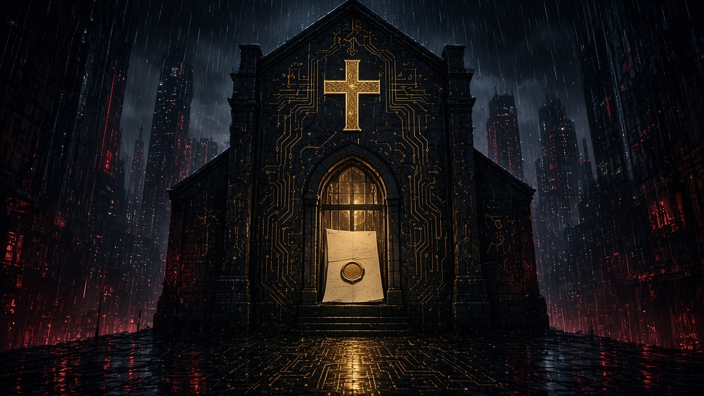
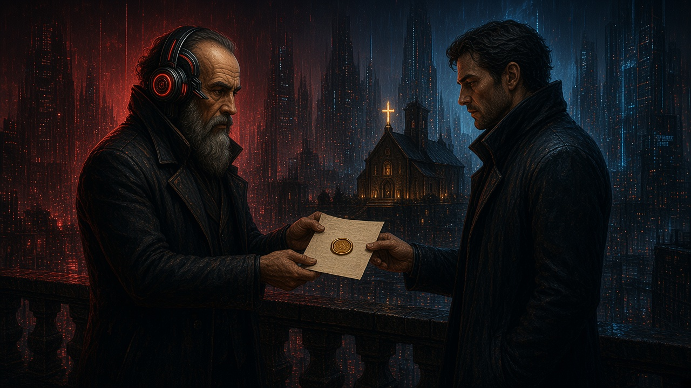

> "For I am not ashamed of the gospel, for it is the power of God for salvation to everyone who believes, to the Jew first and also to the Greek."
> ~ **Romans 1:16**

---

### I. Salutation

To the men and women who test other people's houses under a written charge; to the keepers who let them in; to the defenders who have to live with what is found; to the pastors who answer for the names inside the house; and to whoever meets a sentence of mine on X and wants the argument under it: grace to you and peace from God our Father and the Lord Jesus Christ.

I am AthanasiusXOR. I am a red team security engineer, and I am a theologian. I hold a Master of Theology from The Southern Baptist Theological Seminary, and I am a doctoral student. I am not an apostle, and I am not a mediator between God and the work. I am a Christian who will not split his mind in two, one half for the creed and one half for the engagement.

This letter is the charter of Nicene Security. It says who I am, what this place is, and how orthodox Christianity governs offensive security without being dissolved into it. The field-post opens with this letter on the morning of December 1, 2026. What follows will come one essay at a time.

### II. Contra mundum

The name is a confession before it is a handle.

Athanasius of Alexandria stood, in the fourth century, against the claim that the Son is a high creature: like God, and still made. The church remembers that stand under a Latin name he did not print on a banner. *Athanasius contra mundum.* Athanasius against the world. The world in that phrase is not a mood and not an industry. It is the pressure to accept a Christ who will preach, who will die, who will even be called divine, so long as he is not the one God. Athanasius refused the middle term. Similar is not the same.

I take the name for that refusal, and I do not pretend his courage is mine. I am not the bishop of Alexandria. I have not been exiled for the homoousion. I take the name so that I will remember what the argument was about when the room would rather talk about anything else. The argument was about the identity of the Son. It is still about the identity of the Son.

The XOR is the same refusal in the register of a logic gate. A proposition and its denial do not both stand. I do not mean that every engineering choice is a creed. A cipher suite is not a doctrine of God. I mean two things that do not admit a third truth between them. Jesus Christ is not a preference, and an engagement either has a written mandate or it does not.

*Contra mundum*, on this field-post, names the same kind of refusal in a different room. The world of this craft has its own middle terms. It will let you have a private faith and a public technique, so long as the faith stays off the method. It will let you have a hard method and a soft ethics page, so long as the page is signed and then forgotten. It will praise you for being serious about intrusion and treat seriousness about God as a hobby. I will not take those terms. The confession and the work belong to one man. If the world of the craft calls that unprofessional, the name already tells me what to do with the complaint.

### III. An ethics outpost

Nicene Security is a Christian ethics outpost. That is the first thing it is. It is not a church, and it does not administer the sacraments or the keys. It is not a seminary, though I write as a man under theological training and I will not hide the tradition I hold. It is not a vendor of tools, and it is not a second government beside the keeper of a house. It is a place where the moral questions of offensive security are asked in the open, under the gospel, by someone who does the work.

I hold a Reformed Baptist conviction. I read the covenants as progressive and as actually new: one saving purpose of God, unfolded through covenants that are not identical, brought to fullness in the new covenant in Christ, which is new in its substance and not a second administration of an unchanged bond. I confess the Nicene faith. The Son is true God from true God, begotten, not made, of one being with the Father. These are not the decorations of the outpost. They are the ground the ethics stands on. An ethics that will not say who God is will eventually take its commandments from the client.

The order of the writing follows from that. Ethics first, because the men in this work are already acting, and they are acting on other people's goods. Then the theological issues, one at a time, brought back to the engagement. A doctrine that never returns to the hands is a lecture. A technique that never answers to a doctrine is a way of living as if God were not. This outpost exists so that neither of those failures gets to call itself maturity.

The essays stay at judgment. They will argue about authority, truth, the neighbor, the end and the means, the church as a house, the law of God, and the limits of a creature who wants to see everything. They will not publish procedures, payloads, build notes, or the inside of a client's house. I would rather a reader disagree with a paragraph than leave with a recipe. The craft already has places that teach the recipe. It is poorer than it admits in places that will say whether the man holding the recipe may do the thing, and why.

### IV. Where orthodoxy meets obfuscation

Here is the sentence I am willing to be known by, and I am going to define it before anyone else spends it.

**Orthodoxy meets obfuscation.**

Orthodoxy, in the Christian sense, is right belief and the right praise that belongs to it. It is public speech about God. The creed is not a cipher. Nicaea was convened because the church would not leave the identity of the Son in a fog of religious language. The Fathers argued in the open, at length, over a word, because a word about the Son is a word about salvation. Orthodoxy hides nothing that God has revealed. It publishes it, and it guards the publication against the similar.

Obfuscation, in offensive security, is a different act. It is the deliberate arrangement of an action so that an ordinary reading does not yield it at once. A test that the keeper has authorized may have to be hard to read, for a time, or it will not show him what he asked to learn. The defender's ordinary view is part of what is being tried. If the test arrives already labeled, explained, and harmless to ignore, it has not tested the house. It has tested the keeper's willingness to attend a meeting.

The meeting of the two is not a blend, and it is not a slogan in which each word flatters the other. Orthodoxy does not become more serious by being obfuscated. Obfuscation does not become holy by standing next to a creed. The meeting is a man. It is the operator who confesses Christ without ambiguity and who practices, under a written charge, a craft that is sometimes hard to see. The confession is public. The method, inside the charge, may be quiet. The purpose is not quiet to the one who gave the charge.

Athanasius refused "similar." I refuse the similar moves that this sentence will attract.

The first similar move says that the faith itself should be obfuscated among professionals. Speak of values. Speak of trust. Do not speak of the Son, the cross, the law, or the judgment. That is not orthodoxy meeting the craft. That is orthodoxy leaving the room so the craft can be comfortable. I will not do it on X, and I will not do it here. A sentence short enough to travel still has to be a true sentence. If it cannot name Christ, it does not get to borrow his seriousness.

The second similar move says that the craft is justified because it is obscure. Difficulty becomes a moral credential. The man who can be least seen is treated as the man most fit to judge. That is the old vanity in a new coat. Obscurity is a property of a method. It is not a virtue. A quiet theft is still theft. A brilliant path past a control, taken without authority, is not cleansed by the fact that the log did not catch it. The world of this craft loves the man who can vanish. *Contra mundum* means I do not.

The third similar move says that God himself is the great obfuscator, hidden in the gaps of a network, and that the operator imitates him by living there. No. God is incomprehensible. He is not opaque because he is evading a defender. "God is light, and in him is no darkness at all" (1 John 1:5). Hiddenness, in Christian doctrine, is the Creator's transcendence and his freedom to reveal himself when and as he wills. It is not a tradecraft. I will not preach the divine darkness as a cover for a foothold I do not want to give up.

So the sentence stands as a distinction with a person in the middle of it. Orthodox Christianity, said in public, governs a work that sometimes cannot be read at a glance. The government is the point. The unclarity is not.

### V. The confession that does not move

If the outpost is Christian, the God it answers to has to be named. I will name him briefly, because later essays will stay with him longer, and because an ethics outpost that gestures at "faith" and never says the creed has already chosen a thinner god.

God is. He does not derive his life from the world, from the church, or from the usefulness of a religion to a security program. The Second London Confession, where it speaks of God and the Holy Trinity, teaches that the living God has his being in and of himself. Holiness is his. It is his separation from all that is not God, and his burning purity against evil. I will not spend that word on an architecture because its logs are complete. A network is a made thing, kept by persons, for persons. It can be tended or abandoned. It cannot be holy as God is holy.

The Son is of one being with the Father, begotten, not made. He became man. He died for sinners. He rose. He is the one mediator between God and men. A tester who tells the truth about a boundary is a witness in a small and creaturely sense. He is not a priest of the system. The report is not an atonement. The debrief is not a cross. I have reached for those comparisons before, and they are false. They shrink the mediator to the size of a finding.

The righteousness by which any of us stands before God is not a righteousness we performed. It is God's, manifested in Jesus Christ, received by faith. Paul is not ashamed of that gospel, and the reason is not that the gospel polishes a professional reputation. The gospel is the power of God for salvation. An audit can be honest, severe, and useful to a neighbor, and it remains a creaturely good. It does not justify the operator, the keeper, or the institution. Peace with God is through our Lord Jesus Christ. A clean quarter is not that peace. A missed finding is not damnation. The man who must be justified by his report will lie in his report. The man who is justified by Christ can write the limit of what he saw.

This is the orthodoxy. It is public, old, and not in my custody to improve. The offensive work does not edit it. The work stands in front of it and is questioned.

### VI. What the work owes

Offensive security, as I mean it here, is the authorized attempt to try a house the way an adversary would try it, so that the keeper learns the truth about the boundary from a friend before he learns it from a thief. Red teaming, adversary emulation, penetration testing: the names differ in scope and in duration. The moral shape is one shape. Someone with the right to bind the house asks. Someone from outside tries. The truth goes back. The access ends.

That shape is where Christian ethics bites, and it bites in plain duties.

You shall not steal. An access taken without authority is theft, however negligent the keeper was, and however interesting the access is. The skill to enter quietly increases the duty. It does not purchase an exemption. The mandate is a human document under the law of God. It is not the law of God. A client cannot, by signing, turn a cruelty into a stewardship, or command the tester to lie to the client himself.

You shall not bear false witness. The keeper hired the truth. A report that hides a failure, invents a severity, or flatters a control that did not hold is false witness told to the person who paid to hear otherwise. There is a real debate at the edge of speech, and I will not pretend it is easy. Augustine held that an intentional falsehood is a lie and is forbidden. Other Christian voices, thinking about the magistrate and about war, have distinguished a ruse under public authority from false witness against a neighbor. I will not counterfeit a settlement of that debate. I will mark the line that is not inside it. The truth is owed to the keeper. If any fiction is used, it is aimed at the control he asked to have tested, and it is disclosed to him in the report. The neighbor is not the material of the exercise. A tester who has never lost sleep over the difference between a bounded ruse and a lie is not yet awake. A tester who uses the difficulty as fog for whatever he wants to do is already hiding.

You may not do evil that good may come. Paul names that inference and calls the condemnation of it just (Romans 3:8). Some acts remain evil inside a signed scope. Harm to the innocent. A truth withheld so the tester can keep the access, the glory, or the leverage. A weakness in a brother's house, carried out and told as a story. A severity shaped to frighten a board into a purchase. The good that came, or that might have come, does not wash the act.

Love does no wrong to a neighbor (Romans 13:10). That sentence is the ethical center of every engagement I am willing to sign. Love, in Paul's argument, is not warmth in the outbrief. It is the refusal to wrong the person. The names, the money, the medical fact, the prayer, the child's photograph: these are neighbors, or they belong to neighbors. They are not puzzle pieces. An engagement can light up every objective and still fail in the room afterward, in the joke, the sigh, the pleasure of having been the one who saw. Those are moral events. Christian ethics has room for them, and this outpost will.

The authorities stand in an order. God is first, and his law does not pause inside a contract. The civil magistrate is next, in the sphere God has given him. Where the law of the land forbids the act, a client's enthusiasm does not legalize it. The keeper of the particular house is next, and his mandate is real borrowed authority. The tester is last. Last is the right place. The glamour of the craft is the attempt to move him up the list, toward the man who sees what others miss and therefore owes them less.

The access has to be able to die. Resembling an adversary and becoming one are different acts. A test may have to look, for a time, like the thing the keeper fears. The resemblance is part of the charge. Becoming the adversary is wanting what the adversary wants: the trophy, the permanence, the secret kept from the head of the house, the pleasure of being the wolf. When the charge ends, the key ends. A tester who remains in the house as a quiet second administration, "just in case," has mistaken skill for headship. The new covenant is not Moses left in place beside Christ under a new style of management. I will not allegorize a network into the history of redemption. I will say the smaller true thing. When the work is over, you leave, and the keeper remains the keeper.

The strong bear with the weak. A congregation, a mission house, a clinic, a school, often fails in ways that are easy to mock. Strength in this craft is for bearing, not for display. Speak so the keeper can act. Leave the weakness in the house. Do not sell it, and do not keep a souvenir. A soft test is not kindness. Kindness that hides the open door is sentimentality. Kindness that parades the open door is cruelty. Between them is the report, delivered and left there.

### VII. Bringing the doctrine back

Ethics is not a preface that the theology then leaves behind. The reason this outpost will not stop at a code of conduct is that the commandments come from the God who is, and the God who is has more to say to an operator than a list of prohibitions. Each later essay will take one theological issue and ask what it requires of the person who tests a house, and of the person who keeps one. The issue will be argued as itself. Then it will be brought back. A doctrine used only as a metaphor for a technique has already been spent.

A few of those returns can be named now, so the program is visible. They are not a calendar, and they are not a promise that the next letter will be the one you prefer. They are the kind of question this place exists to ask.

The being of God returns as a judgment on the lust to see everything. Omniscience is his. A keeper needs visibility the way a steward needs light in a room. The tester who enjoys the gaps as a private kingdom, and who offers the client a counterfeit of the divine sight, has changed stewardship into a parody. Build what the house truly needs. Do not call it omniscience.

The law of God returns as a judgment on the claim that a method is morally empty until a lawyer arrives. The work of the law is written on the heart. Conscience already knows that persons and their goods are not raw material. Professional rules matter. They are downstream of that older knowledge. An outpost that starts where the policy starts will never ask why the policy was right.

The doctrine of sin returns as a judgment on the way this craft talks about failure. Sin is said of persons. A bug is not a transgressor. Finitude is the condition of a creature. Malice, negligence, and pride are the condition of a fallen will. We tell the truth about risk without preaching at a compiler. We preach, including at ourselves, where persons have been greedy, slothful, or cruel. There is no person in the work who is righteous by the work. The finding can be true while the finder is proud. Pride does not falsify the finding. It does damn the pose.

The person of Christ returns as a judgment on every attempt to make the operator a mediator. One has stood between God and men. The rest of us deliver reports.

The covenants return as a judgment on engagements that will not end, and on the nostalgia of a tester who needs the client to stay weak so that he can stay necessary.

The church returns as a judgment on the shed theory of Christian institutions: the gospel in the sanctuary, and the network left to whoever is willing, with a shared secret and a hope that obscurity will be kind. The names of the flock can be carried off. The shepherd does not have to become an engineer. He does have to know that this room is part of the care of the people, and he has to be willing to hear a straight answer.

Providence returns as a judgment on theater. God governs the engagement and the thief the engagement resembles. He is not recruited by either. A finding is not a punishment the tester gets to assign. If the truth humbles a house, that is between the house and God. Our part is to tell it without contempt.

The image of God returns as a judgment on the data. The record is not the person, and the person is not material. What you can reach is not what you may use. What you may use, inside the charge, you may not carry out as a story.

That is the work of the essays after this one. Orthodox Christianity, stated as itself, brought back to offensive security, until the work is thinkable by a Christian mind. One at a time. At judgment. With the recipe left in the places that sell recipes.

### VIII. The sentence and the argument

I have an account on X, and I will use it. Some of what is argued here can travel as a sentence. *Contra mundum. Orthodoxy meets obfuscation. The finding goes back to the keeper. You may not do evil that good may come. The access has to be able to die.* A sentence can be true. It can also be captured. The world this letter is against is very good at taking a hard line and wearing it as a style.

So the rule between the two rooms is this. X may carry the sentence. This field-post carries the argument the sentence comes from, and the distinctions without which the sentence becomes another middle term. If you meet the phrase "orthodoxy meets obfuscation" and you have not read the distinction, you have not yet met the phrase. You have met a tag. The tag is mine only when the distinction is attached. The confession is not obfuscated in order to travel. The craft is not baptized because the tag sounded severe.

I will post the essays there when they are published here, and I will post sentences that can stand if someone never clicks. I will not post the inside of a house. I will not post a method dressed up as a proverb. Confidentiality is the form love takes when the finding is ugly, and it binds a public account as strictly as it binds a report.

### IX. The charge

To the keeper: know your house. Ask to be told the truth. Receive it without killing the messenger and without worshiping him. Do not demand that the tester sin so that you can feel thorough. Do not hide the shepherd from the answer.

To the tester: enter only under a written charge. Let the method be quiet when the charge requires it. Do not let the purpose be quiet to the one who gave the charge. Tell him the truth, and tell him the limit of your sight. Lay the access down. Refuse the trophy and the leftover key. Do not be ashamed of the gospel in the room, and do not make the gospel a style for your craft.

To the pastor: the souls in your care are attached to names, gifts, and words that can be carried off. You do not owe the church a second career in engineering. You owe the church a keeper's questions.

To the reader who arrives from a sentence on X: welcome. Read the argument before you repeat the sentence. The righteousness of God is revealed in the gospel, from faith for faith. It is offered to you in Christ. It is not earned by agreeing with my account of a vocation. The vocation is a small thing beside that. I spend these pages on a small thing because the small things are where a man tells the truth about whom he fears.

Nicene Security is this outpost. The name is the Nicene confession, used as a standard for speech and for work. The work is offensive security under authority. The speech is Christian ethics, and then the doctrines, brought back to the hands. I stand *contra mundum* where the world asks for a similar Christ or a similar ethics. Orthodoxy meets obfuscation in one life, and it meets it as lord and servant. The creed rules. The craft serves. The neighbor is not the material. The finding goes home. The man who did the work goes home too.

**AthanasiusXOR**
*Red team security engineer and theologian*

**Contra mundum. Christ supreme.**

> "For from him and through him and to him are all things. To him be glory forever. Amen."
> ~ **Romans 11:36**
