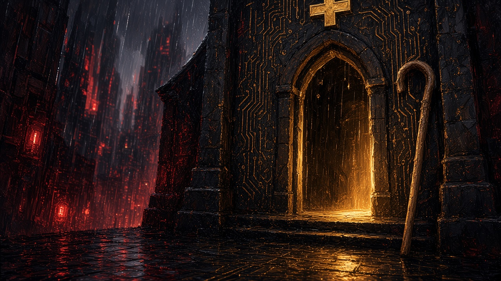

> "Pay careful attention to yourselves and to all the flock, in which the Holy Spirit has made you overseers, to care for the church of God, which he obtained with his own blood."
> ~ **Acts 20:28**

There is a theory of Christian institutions that never gets written down, because writing it down would embarrass it. The gospel is in the sanctuary. The network is in a shed behind the sanctuary, and the shed belongs to whoever is willing, with a shared password and a hope that obscurity will be kind. The theory feels like spirituality. It is a division Paul did not make. The flock the Spirit gives a man to oversee is not a flock of souls in the abstract. It is these people, with names, gifts, words, and records that can be carried off. The shed is part of the care. Leaving it to chance is not faith. It is a refusal to look at one of the ways the sheep are actually harmed.

The church is the people Christ obtained with his own blood. The Second London Confession receives that with the seriousness of a gathered church under the Word and the ordinances, not as a metaphor for every nonprofit with a cross on the letterhead. I am not turning Nicene Security into a presbytery. I am saying that where a church, a mission house, a clinic, or a school holds the names of a people, the holding is an act of care. Obscurity is not a shepherd. It is a hope that the wolf is busy elsewhere.

### What the shepherd does not owe

He does not owe the church a second career. Acts 20 does not commission the elders to become engineers. It commissions them to pay attention to themselves and to all the flock. Attention can be spent on the wrong syllabus. A pastor who vanishes into the appliances has left the Word, the prayer, and the souls in order to tend a rack, and he will tend it badly besides. The Epistle said this on purpose. You do not owe the church a second vocation. You owe the church a keeper's questions.

You owe the willingness to hear a straight answer. The strong in this craft are for bearing, not for display. A congregation often fails in ways that are easy to mock: the password on a sticky note, the old machine, the shared login, the mailbox no one watches. Mockery is not the report. A soft silence is not kindness either. Kindness that hides the open door is sentimentality. Kindness that parades the open door, in a conference story or a joke at dinner, is cruelty. Between them is the answer, given so the shepherd can act, and then left in the house.

[CISA's public counsel for houses of worship](https://www.cisa.gov/topics/physical-security/protecting-houses-worship) is the sort of help that respects this limit. It speaks to congregations as congregations, about care of a gathered people, and it does not require the pastor to become the technician before he is allowed to take the care seriously. I am not turning that page into a checklist on this one. I am glad it exists in public, because the shed theory thrives on the idea that serious attention is worldly. It is not worldly to know that the names can leave. It is pastoral.

The records themselves are a trust. The [NIST Privacy Framework](https://www.nist.gov/privacy-framework) is a secular instrument for thinking about how an institution handles what it holds on persons. A church may use it without pretending it is a confession. The confession is already stricter. The names belong to persons made in the image of God, obtained by blood, not to a database that has achieved personhood. A framework can help a deacon ask what is collected and who can carry it out. It cannot tell him the worth of a soul. He should already know the worth. The framework is for the shed. The worth is from the sanctuary, and the worth is why the shed matters.

### The theory, looked at

The shed theory says that godliness is a willingness to be unimpressed by "worldly" systems. Sometimes that sentence is a true warning against vanity and against the lust for omniscience I wrote about in February. Often it is a cover for neglect. The widow's gift is recorded. The child's name is recorded. The counseling note is recorded. The member who fled a violent house is recorded. These are not appliances. They are the flock, in the form a thief can carry. A spirituality that protects the pulpit and abandons the list has not understood what the list is. It is the people, written down.

There is a mirror failure among those of us who test. We can treat a weak congregation as an easy win, or as content. The blood Christ paid is not content. A finding in a church is a finding about a trust. It goes back to the overseer. It does not go into a talk. The same law that forbids parading a firm's wound forbids parading a church's, and the second parade is worse, because the people did not hire a brand. They gathered under a name that is not ours.

A Christian institution can hire help. The help should know it is help. The shepherd remains the shepherd when the guest arrives and when the guest leaves. If the guest finds that the names can be carried off, he says so in a voice the shepherd can act on. He does not despise the shepherd for having given his life to the Word instead of to the rack. That division of labor is not the shed theory. The shed theory is the division of care. Care was never divided. Attention may be. The overseer asks, funds, and hears. Someone who knows the craft answers. The wolf does not get a vote on the arrangement, and obscurity does not get to count as an arrangement.

### A straight answer

Pay attention to the flock you actually have, including the form in which their names can leave the building. Ask someone who will tell you the truth. Do not ask him to sin so that you can feel thorough, and do not ask him to stay forever so that you can avoid learning. Receive the answer without killing him and without making him a priest. Then act. The Spirit made you an overseer of people Christ bought. The shed is not outside that sentence.

**AthanasiusXOR**
*Red team security engineer and theologian*

**Contra mundum. Christ supreme.**
