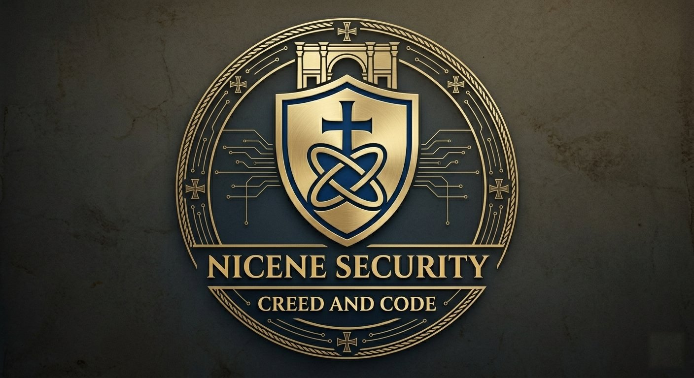
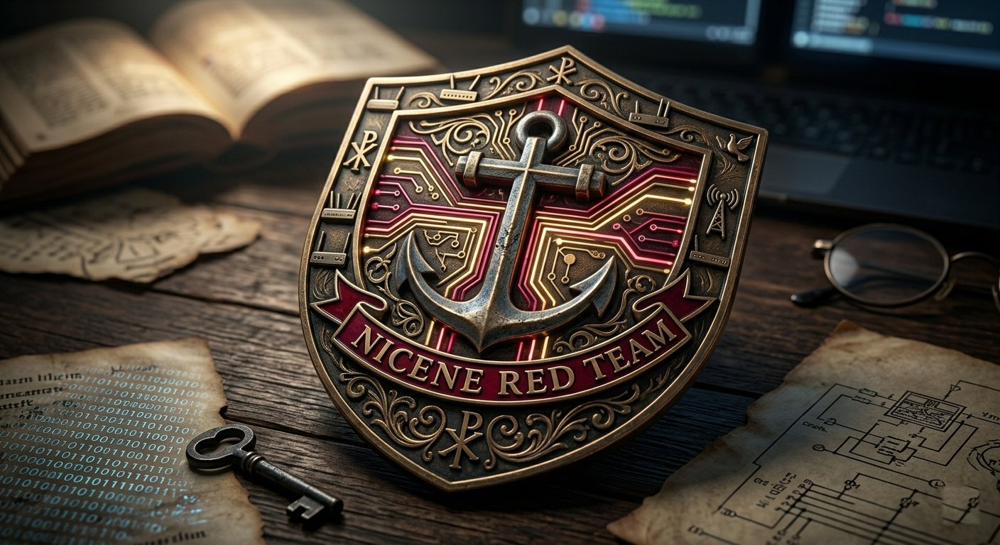

# About AthanasiusXOR

> "Am I now seeking the approval of man, or of God? Or am I trying to please man? If I were still trying to please man, I would not be a servant of Christ."
> ~ **Galatians 1:10**

---

I write as **AthanasiusXOR**. The work is offensive security under authority. The study is theology. I hold a Master of Theology from [The Southern Baptist Theological Seminary](https://www.sbts.edu/), and I am a doctoral student.

The name is a confession before it is a handle. Athanasius of Alexandria stood against the claim that the Son is a high creature. The XOR is that same refusal in another key: a proposition and its denial do not both stand. I do not mean that every engineering choice is a creed. I mean that the person of Christ is not a preference, and that an engagement either has a written mandate or it does not.

---

## What the writing is for

The field-post takes one essay at a time, beginning January 1, 2027. Each essay starts from a doctrine — the being of God, the covenants, the moral law, the church — and asks what that doctrine requires of an operator who tests someone else's house. The essays stay at judgment. They do not publish procedures.

## The work

An authorized test tells the truth about a boundary. The finding belongs to the one who keeps the house. God is not the system, the system is not holy, and the operator is not a mediator. Holiness is his. Stewardship is ours. A vulnerability reported inside a written scope is truth-telling. A vulnerability taken past that scope is theft.

## What I bring to the page

- Nicene orthodoxy, held as confession.
- Reformed Baptist conviction, read through the covenants as progressive and as actually new.
- Offensive security as a bounded vocation: adversary emulation, the judgment of a finding, and the return of that finding to the keeper.
- The moral questions under the work: authority, proportion, the prohibition on doing evil that good may come, and the difference between resembling an adversary and becoming one.

I do not split the confession from the engagement. The method of a test may be quiet. The conduct is not.

**Contra mundum. Christ supreme.**

