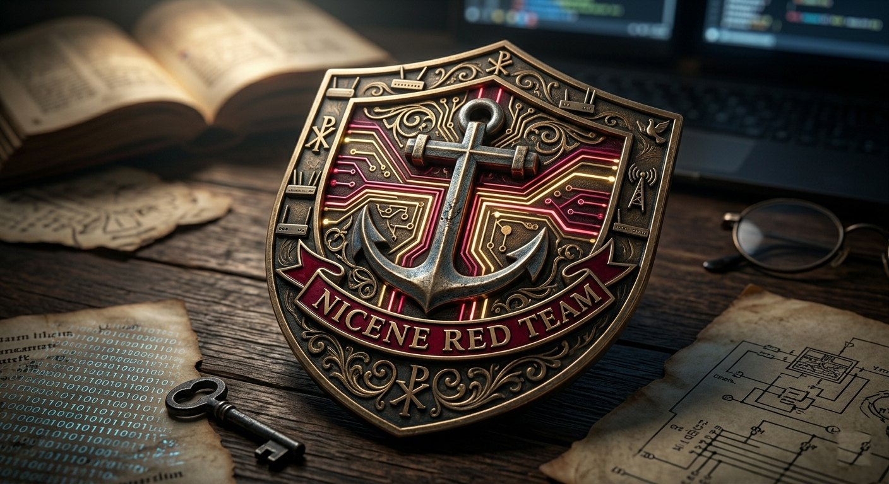
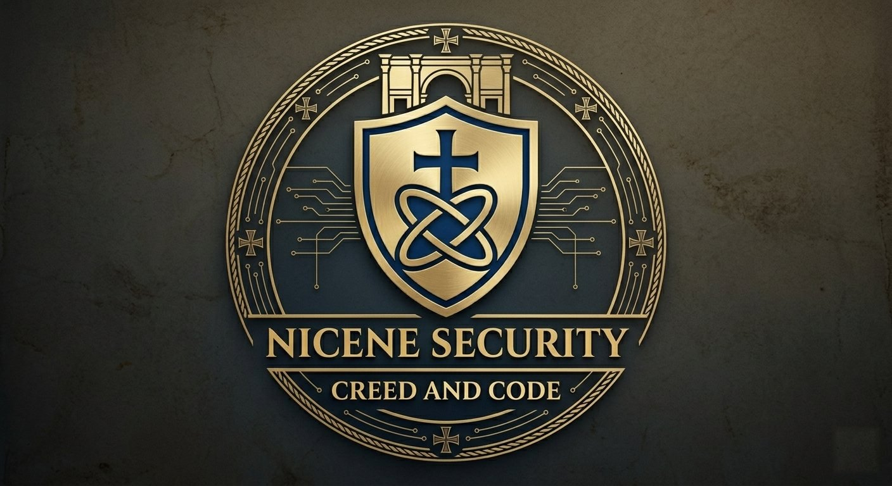

# Nicene Security

> "Be watchful, stand firm in the faith, act like men, be strong."
> ~ **1 Corinthians 16:13**

---

**Nicene Security** is a Christian ethics outpost, opened *contra mundum*. The name is the standard. Nicaea confessed the Son as of one being with the Father, against a Christ who was only like God. That confession is the measure of the writing, and of any work done under the name. Orthodoxy meets obfuscation here as lord and servant: the creed is said in public, and the craft, under a written charge, may be hard to read.

---

## What is published here

Essays on Christian ethics and on the doctrines that judge offensive security, one at a time. The First Epistle is the charter. They are for operators, defenders, and pastors who need the doctrine and the work in the same paragraph. Short sentences may go out on X. The argument stays here, where the distinction can be kept.

## The service

Two charges are carried under one name. Both of them are the Council's kind of work: a true word, said clearly, in a place that would rather leave the matter fogged.

**The field-post.** Public orthodoxy. Christian ethics for people who do offensive security, and then the doctrines, one at a time, brought back to the engagement. The public conversation around this craft obfuscates. It will take a private faith and a public technique. It will take a hard method and a soft ethics page. This page refuses the middle term. The Son is named. The duty is named. No procedure is published.

**The engagement.** Adversary emulation and penetration testing inside a written scope, including for churches and ministries when that is the house to be kept. A test may have to be hard to read, or it does not try what the keeper asked to have tried. The purpose is not hard to read. The report is the deliverable: a true account, given to the keeper, in the midst of a method that obfuscates. When the charge ends, the access ends. The method is not an essay, and the essay is not a method.

## The bounds

1. No test without a written mandate.
2. The finding goes back to the keeper of the house.
3. What was learned in confidence stays there.
4. The stability of the environment is part of the charge.
5. A quiet method does not excuse a hidden purpose.

> "And we prayed to our God and set a guard as a protection against them day and night."
> ~ **Nehemiah 4:9**

**Contra mundum. Christ supreme.**

