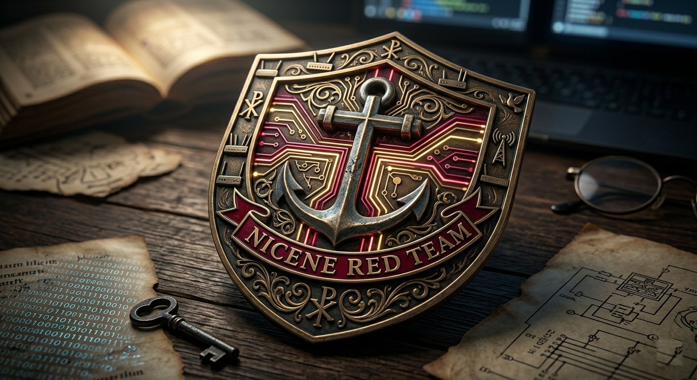
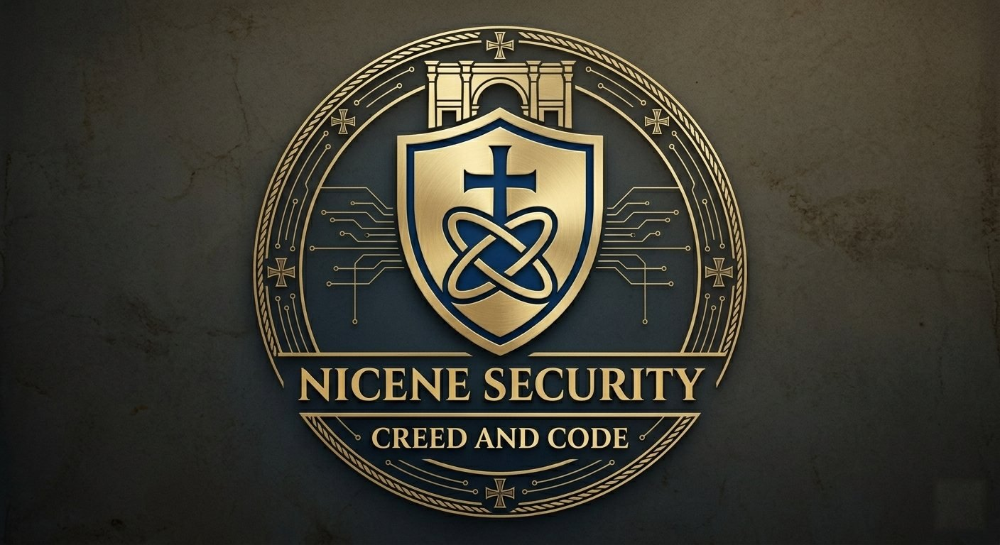

# Nicene Security

> "Be watchful, stand firm in the faith, act like men, be strong."
> ~ **1 Corinthians 16:13**

---

**Nicene Security** is a field-post. The name is the standard. Nicaea confessed the Son as of one being with the Father, against a Christ who was only like God. That confession is the measure of the writing, and of any work done under the name.

---

## What is published here

Essays on Christian doctrine and on the moral shape of offensive security, one at a time. The first returns on the morning of January 1, 2027. They are for operators, defenders, and pastors who need the doctrine and the work in the same paragraph.

## The bounds

1. No test without a written mandate.
2. The finding goes back to the keeper of the house.
3. What was learned in confidence stays there.
4. The stability of the environment is part of the charge.
5. A quiet method does not excuse a hidden purpose.

## Engagements

Adversary emulation and penetration testing inside a written scope, including for churches and ministries when that is the house to be kept. The report is the deliverable. The method is not an essay.

> "And we prayed to our God and set a guard as a protection against them day and night."
> ~ **Nehemiah 4:9**

**Contra mundum. Christ supreme.**

